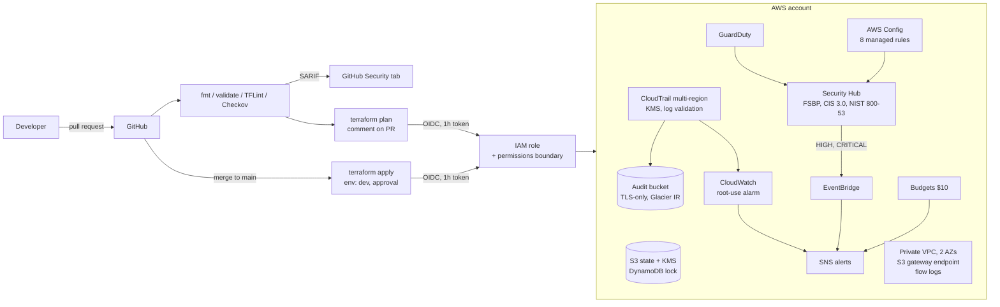
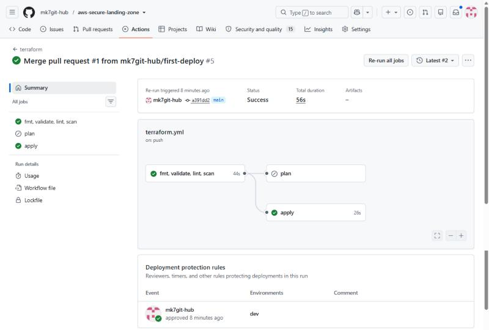
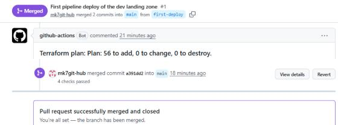
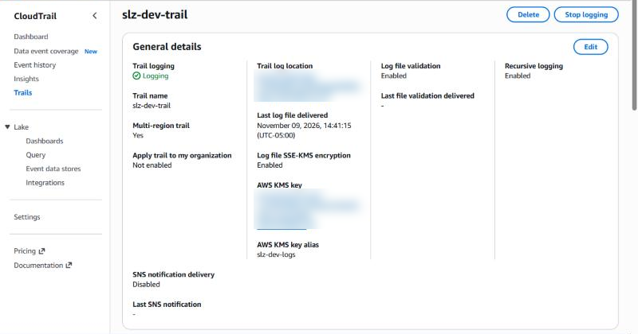
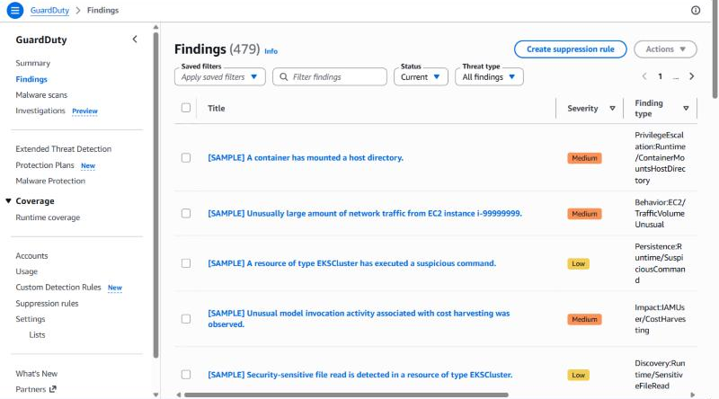
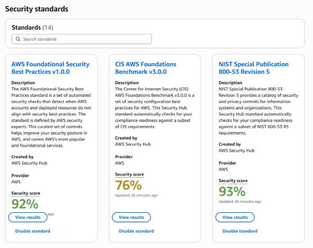

# AWS Secure Landing Zone (Terraform + GitHub Actions)


A security-first AWS account baseline, built as code and delivered through a CI/CD pipeline with no stored AWS keys. Every change is formatted, validated, linted and scanned against CIS and AWS best practices before a plan is posted to the pull request, and applied only from `main` after approval.

**Problem:** new AWS accounts start with no audit trail, no threat detection and no guardrails, and click-ops setup drifts. **Solution:** one repo that stands up the controls a regulated (NIST 800-171 / CMMC) team expects on day one, and proves them in CI.

## Architecture



## What it deploys

| Area | Controls |
| --- | --- |
| Identity | GitHub OIDC provider, CI role limited to this repo's `main` and PRs, permissions boundary that denies IAM user/key creation and disabling CloudTrail or GuardDuty, IAM Access Analyzer, strong password policy |
| Network | Private-only VPC across 2 AZs, no IGW or NAT, locked default security group, free S3 gateway endpoint, optional SSM/KMS/STS/Logs interface endpoints, VPC flow logs to encrypted CloudWatch |
| Logging | Multi-region CloudTrail with log file validation, KMS encryption, CloudWatch delivery, TLS-only versioned bucket with lifecycle to Glacier Instant Retrieval |
| Detection | GuardDuty (with S3 protection), Security Hub with AWS Foundational, CIS 3.0 and NIST 800-53 Rev 5 standards, EventBridge routing of HIGH/CRITICAL findings to SNS, CIS root-use metric alarm |
| Compliance | AWS Config recorder plus rules for S3 public access, encryption, root MFA, admin policies, CloudTrail, flow logs, EBS encryption, open SSH; account-level S3 public access block and EBS default encryption |
| Cost | AWS Budgets at $10/month with 50% actual and 100% forecast alerts |
| State | S3 backend with KMS, versioning, TLS-only policy, DynamoDB locking with PITR |

## Pipeline

| Event | Jobs |
| --- | --- |
| Pull request | `terraform fmt -check`, `validate`, TFLint (AWS ruleset), Checkov (results to the Security tab), `plan` posted as a PR comment |
| Merge to `main` | Same checks, then `apply` in the `dev` environment (add a required reviewer for a manual gate) |
| Manual | `destroy` workflow, requires typing `DESTROY` |

Checkov: 304 checks pass, 0 fail. The 15 skips are deliberate and each carries an inline reason (see [docs/checkov-exceptions.md](docs/checkov-exceptions.md)).

## Deploy it

Prerequisites: a fresh AWS account (do not use an employer account), Terraform 1.6+, AWS CLI signed in as an admin for the one-time bootstrap.

```bash
# 1. Bootstrap state + OIDC role (once, from your laptop or Codespaces)
cd bootstrap
terraform init
terraform apply -var owner=yourname -var github_repo=YOURUSER/aws-secure-landing-zone
terraform output   # note state_bucket, lock_table, ci_role_arn
```

2. In GitHub, **Settings → Secrets and variables → Actions**:
   - Variables: `AWS_ROLE_ARN`, `TF_STATE_BUCKET`, `TF_LOCK_TABLE`, `AWS_REGION` (us-east-1), `TF_OWNER`
   - Secret: `ALERT_EMAIL`
3. **Settings → Environments → New environment `dev`**, add yourself as a required reviewer.
4. Open a pull request with any change under `envs/` or `modules/`. Review the plan comment, merge, approve the apply.
5. Confirm the SNS subscription email.

Local checks: `make check` (fmt, validate, TFLint, Checkov).

## Cost and teardown

About $2 to $6 for a few days of testing: CloudTrail's first management trail is free, GuardDuty and Security Hub have 30-day free trials, Config charges about $0.003 per recorded item, and there is no NAT gateway. Interface endpoints add about $7 per endpoint per AZ per month, so they are off by default.

Tear down: run the **destroy** workflow, then `terraform destroy` in `bootstrap/` (empty the state bucket first). Security Hub and GuardDuty stop billing once disabled.

## Evidence

Deployed to a dedicated AWS account through the pipeline above.

**Pipeline:** lint and scan, then an apply gated on manual approval in the `dev` environment.



**Plan reviewed on the pull request before merge:**



**CloudTrail:** multi-region, KMS-encrypted, log file validation on.



**GuardDuty** with sample findings generated to verify detection and alert routing:



**Security Hub compliance scores** about a day after deploy (the account is a fresh lab; the remaining failed controls are tracked as findings, not hidden):

| Standard | Score |
| --- | --- |
| AWS Foundational Security Best Practices v1.0.0 | 92% |
| NIST SP 800-53 Rev 5 | 93% |
| CIS AWS Foundations Benchmark v3.0.0 | 76% |



### What broke on the first deploy, and the fixes

| Failure | Cause | Fix |
| --- | --- | --- |
| TFLint failed | Modules did not declare Terraform and provider versions | `versions.tf` in every module |
| OIDC "Not authorized to perform sts:AssumeRoleWithWebIdentity" | Since July 2026 GitHub puts immutable owner and repo IDs in the OIDC `sub` claim for new repos | Trust policy matches `repo:<owner>@<id>/<repo>@<id>:...` |
| AccessDenied on CloudWatch alarm, password policy, EventBridge rule | Least-privilege CI role lacked those three actions | Granted exactly those actions; the boundary still denies the dangerous ones |

## Roadmap

- Multi-account with AWS Organizations, SCPs and a delegated security admin account
- Auto-remediation: EventBridge → Lambda closes public S3 buckets (project P4)
- GovCloud variant (`aws-us-gov` partition is already used via `aws_partition`)
- OPA/Conftest policies on the plan JSON

## Mapping to NIST 800-171 / CMMC L2 (selected)

| Practice | Implemented by |
| --- | --- |
| AU.L2-3.3.1 audit records | CloudTrail multi-region, CloudWatch, 365-day retention |
| AU.L2-3.3.8 protect audit info | KMS, log file validation, TLS-only bucket, versioning |
| AC.L2-3.1.5 least privilege | OIDC role scoped to repo/branch, permissions boundary |
| SC.L2-3.13.11 FIPS-validated crypto at rest | KMS (FIPS 140-2 validated HSMs) |
| SI.L2-3.14.6 monitor for attacks | GuardDuty, Security Hub, EventBridge alerts |
| CM.L2-3.4.2 baseline configurations | Terraform as the baseline, AWS Config rules for drift |

Design decisions and trade-offs: [docs/design-decisions.md](docs/design-decisions.md).
